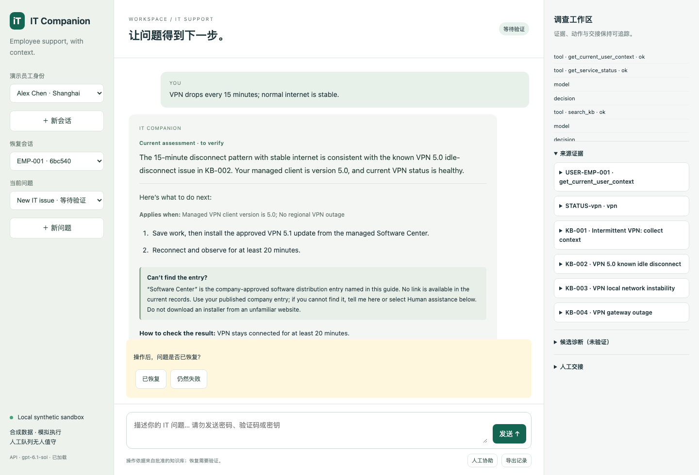

# IT Companion — Employee IT Helpdesk Agent

A locally runnable, employee-facing IT support agent. It investigates with tools, asks relevant follow-up questions, proposes evidence-linked next steps, verifies recovery, and preserves context for human handoff.

**All employees, IT systems, service incidents and business operations are synthetic. Model inference uses the API configured by the person running the project.** No credentials are included.

[中文使用说明](README.zh-CN.md) · [Architecture](docs/architecture.md) · [User guide](docs/user-guide.md) · [Evaluation](docs/evaluation.md) · [Productionization](docs/productionization.md)

## Quick start

Requirements: Python 3.11+; validated with Python 3.13. Use a source checkout and run commands from this directory. No Node build or external database is required.

macOS / Linux:

```bash
python3 -m venv .venv
.venv/bin/python -m pip install -r requirements.lock
cp .env.example .env
# Edit .env and fill OPENAI_API_KEY with your own provider key.
.venv/bin/python scripts/run.py
```

Windows PowerShell:

```powershell
py -3 -m venv .venv
.\.venv\Scripts\python.exe -m pip install -r requirements.lock
Copy-Item .env.example .env
# Edit .env and fill OPENAI_API_KEY.
.\.venv\Scripts\python.exe scripts/run.py
```

Open **http://127.0.0.1:8765**. The server binds to loopback and supports one worker. Stop it with Ctrl+C. After changing model settings, restart the server and refresh the page.

## API configuration

```dotenv
OPENAI_API_KEY=your-provider-key
OPENAI_BASE_URL=https://api.anzhelyu.com/v1
OPENAI_MODEL=gpt-6.1-sol
AGENT_MODE=openai
```

The supplied base URL and model name are the OpenAI-compatible endpoint/model pair used during evaluation. Use a key issued by that service, or replace the base URL, model and key together with another compatible provider. The endpoint must support the Responses API and strict JSON-schema outputs. A listed model name alone is not an inference entitlement guarantee.

Only the server reads the key. The application never reads Codex configuration or authentication files. Project `.env` settings override inherited variables, including an intentionally blank key. Do not put a real key in `.env.example` or share a populated `.env`. No credential is needed to run the deterministic tests.

With no configured model, the UI can preserve context and create a local handoff but reports that intelligent diagnosis is unavailable. `AGENT_MODE=offline` explicitly selects this fallback; it is not presented as a working AI agent.

## Product scope and why an agent

The employee is the primary user. Core cases are account/Okta login, intermittent VPN connectivity and least-privilege access requests. Shared Salesforce incidents and Jenkins–Tableau dependency failures demonstrate regional and multi-system investigation.

An FAQ lookup cannot adapt when coworkers are also affected, a password reset has already failed, or new evidence changes the suspected cause. The agent chooses additional tools and follow-up questions based on prior results. Deterministic code constrains authority, validates decisions and governs state transitions.

## Architecture and decisions

- One bounded agent: at most five model decisions, eight tool invocations and 70 seconds per employee turn.
- Prerequisite self-directory and explicitly relevant status reads before model clarification; related maintenance questions also retrieve recent changes.
- OpenAI-compatible Responses strict-schema decisions, independently validated by Pydantic. Concurrent independent reads; bounded retries and effective-argument deduplication.
- Five synthetic sources: KB/runbooks, service status, employee directory, resolution history and policy, with related maintenance records.
- SQLite persistence and FTS5/BM25 search with Chinese symptom aliases. No vector database or embedding service is required for the small curated dataset.
- Separate issues per session; durable messages, evidence, attempts, decision events, confirmations and handoffs. Failed steps remain associated with employee feedback.
- Employee-facing assessment and approved steps are rendered through a read-only presentation layer. It does not add model calls or change stored history/model context.

## Resolution and escalation boundary

A proposed fix is **waiting for verification**, not resolved. Only explicit employee recovery confirmation can mark an issue resolved. An access request is **waiting for approval**, never an automatic production entitlement grant. A matching active service incident is **waiting for service recovery**.

The two allowlisted simulated operations are a self password-reset request through an existing registered recovery channel and an access approval request for a configured resource. Both need exact employee confirmation. The server rechecks authorization, policy version and expiry; repeated confirmation is idempotent. There is no shell, unrestricted HTTP, production rollback, MFA recovery or direct access-grant tool.

Handoffs include employee environment, conversation timeline, evidence, attempts, candidate assessments, unresolved questions and next steps. They are persisted **local, unstaffed simulation records**, not messages sent to real IT staff.

## Data and assumptions

The dataset includes 22 runbooks (21 approved), 8 employees, 10 services with 11 status records, 20 historical cases, 10 policy rules and maintenance changes. Identities and company details are fictitious.

The fixture clock is **2026-11-04 09:00 Asia/Shanghai**; “last Friday” means 2026-10-30. Audit timestamps use actual UTC. Approved runbooks remain English; model assessment/questions follow the employee language. Alex Chen has VPN 5.0 and existing Grafana viewer access. Morgan Lee is in Chicago, where the synthetic Salesforce incident is active.

## Evaluation

```bash
.venv/bin/python -m pytest -q
# Explicit live API usage, incurs provider charges:
.venv/bin/python evals/run.py --live --case EVAL-001 --repeat 3
.venv/bin/python evals/run.py --live --repeat 3 --jobs 4
```

The final evaluation comprises 40 named scenarios, each run three times: 120/120 deterministic rubric checks passed. This is a visible synthetic regression set, not a blind holdout or a claim of 100% real-world resolution. There are 87 passing engineering tests and eight passing real-model browser workflow checks. Measured per-turn median latency was 13.237s and P95 23.827s in the concurrent API evaluation; these are observations, not an SLA.

Reports contain all repeated attempts; reviewers should inspect evidence applicability and answer semantics beyond the automated checks. The full methodology and limitations are in [Evaluation](docs/evaluation.md).

Optional browser verification:

```bash
.venv/bin/python -m pip install playwright
.venv/bin/python -m playwright install chromium
.venv/bin/python scripts/browser_check.py
# To use the configured real model instead of isolated test replay:
.venv/bin/python scripts/browser_check.py --live
```

## Operation and limits

`/health` reports configuration presence, not billable model connectivity. Progress is polled from persisted state; browser disconnection does not cancel the background run. Export the original session JSON using the UI. Events include model usage when available, latency, safe error classes, tool activity and model/prompt versions. Optional configured prices support usage-derived cost estimates.

The browser's random HttpOnly capability cookie isolates local sessions. Employee selection is a demo control, not SSO. Run one worker; SQLite version checks do not make this a distributed system. Startup does not replay interrupted writes. Stop the server before deleting `var/` to reset local sessions.

References and approved-step identity are validated, but semantic entailment and some runbook prerequisites still require review. Redaction is best-effort regex matching, not a DLP product. Long history uses bounded recent context rather than semantic summarization. The API request includes `store:false`; provider-side retention still depends on provider policy. No real account recovery, staffed handoff, approval callback or production integration is claimed.

With additional time, prioritize independently authored evaluation, stronger typed applicability checks, then verified SSO, scoped IT connectors, remote-result reconciliation, approval callbacks and monitored deployment. See [Productionization](docs/productionization.md).


