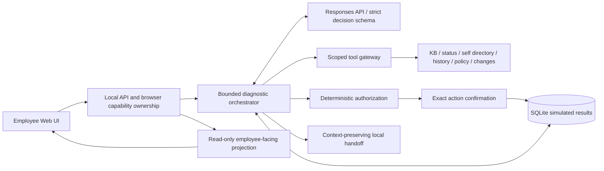

# Architecture

## Components

| Module | Responsibility |
|---|---|
| `domain.py` | Strict employee-request, tool-query and model-decision contracts |
| `provider.py` | OpenAI-compatible Responses transport, strict schema parsing, bounded retries and safe errors |
| `engine.py` | Adaptive investigation loop, evidence checks, workflow bounds, proposals, confirmation and handoff |
| `tools.py` | Self-scoped reads, result envelopes and independent operation policy |
| `diagnostics.py` | Effective query deduplication, known-information and feedback invariants |
| `storage.py` | FTS5 indexing, SQLite transactions, optimistic versions, request IDs and startup recovery |
| `presentation.py` | Non-persisted assessment, approved-step and workflow descriptions for the employee |
| `observability.py` | Token/call counts and optional configured-price estimates |
| `evaluation.py` | Deterministic transcript-level evaluation rubrics |
| `api.py`, `web/` | Session ownership, same-origin boundaries, progress polling and UI controls |

## Investigation

Each turn persists redacted input, retrieves self context and explicitly relevant service status, and retrieves changes for relevant maintenance questions. The model then chooses read tools, clarifications, approved guidance, a simulated action request, a service-incident association or human handoff.

Independent reads can run concurrently. Tool arguments are validated, self identity is server-injected and repeated equivalent reads are not endlessly retried. Failed reads remain explicit unknowns. A rejected model decision can be corrected within the same original decision/tool/time budget; it cannot increase authority.

Approved guidance must refer to retrieved documents and required evidence. Version-sensitive VPN guidance additionally checks directory version and service health. Historical similarity is advisory; current regional status and authorization policy have their own authority. A maintenance correlation is not automatically a confirmed root cause.

## State semantics

Investigation can lead to waiting for employee information, waiting for verification, waiting for confirmation, waiting for approval, waiting for service recovery or escalation. Only explicit employee recovery feedback marks an issue resolved. Diagnostic-only guidance waits for information; failed steps are recorded and not blindly repeated.

A session may contain separate issues, each with its own evidence, attempts, hypotheses and active action. Pending confirmation blocks switching issues until accepted or cancelled. Terminal/approval states require a new issue for a different request.

## Authority and side effects

Only simulated self password-reset submission and allowlisted access-request submission are available. Confirmation is bound to stored exact parameters, employee, issue, policy version and expiry; authorization is checked again at execution. Local action result and state are committed transactionally, with idempotent repeated confirmation. This local property is not a remote exactly-once guarantee.

No generic execution or privileged production tool exists. MFA recovery, suspicious account activity and production changes require human handling. Handoffs persist conversation, user environment, evidence, attempts, hypotheses and unresolved items in an unstaffed local queue.

## Persistence, presentation and observations

The app factory creates one SQLite-backed instance. Module import does not open/recover a default database. Startup marks interrupted runs without replaying writes. Optimistic versions prevent stale updates; one worker is required.

The presentation layer deep-copies canonical state, associates the appropriate accepted decision with each message, and exposes the assessment with an uncertainty label. Raw messages remain the model context and audit export. It does not make an additional generation call or alter decisions. Rendering uses text nodes and same-origin CSP.

Structured events contain safe model/tool errors, tool latency, run IDs, model/prompt versions and available usage. Credentials are read only on the server. The UI exposes synthetic records and local workflow state, not model private chain-of-thought.
